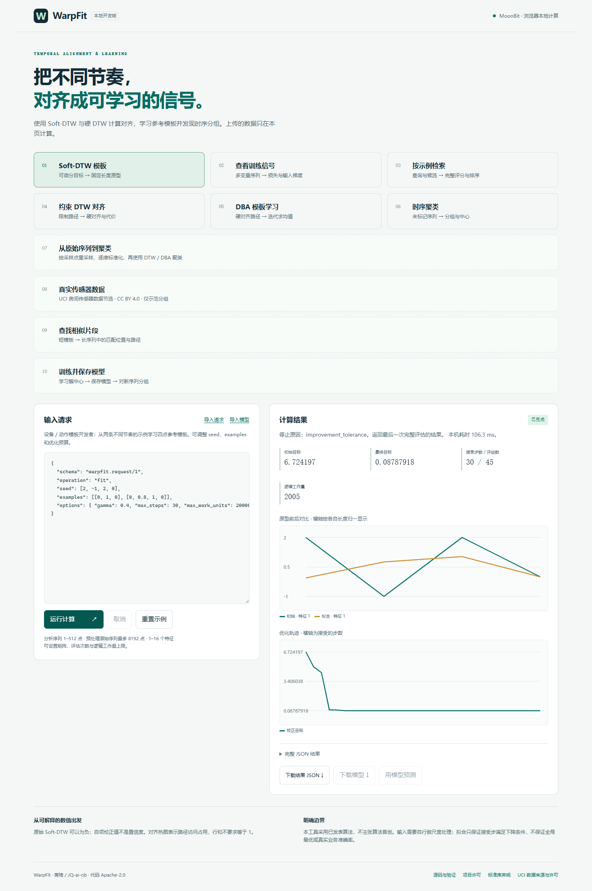

# WarpFit — 可微分时序对齐与原型拟合

给长度和节奏不同的数值序列提供**可学习的对齐目标**：原始 Soft-DTW、自项校正值、两侧输入梯度、软对齐占用；进一步学习固定长度参考模板，并对完整候选集进行示例检索。

目标用户是 MoonBit 时序模型、传感器周期与离线数值应用开发者。逐点误差和直接平均要求采样位置一致；普通 DTW 距离不直接给出平滑训练梯度。WarpFit 自己计算、求导和优化，不依赖 Python 运行时或外部学习服务，也不是其他参赛项目的插件。浏览器演示在本地 Worker 计算用户数据。

维护者 / 个人参赛申请人：**蒋琦**；GitHub / Mooncakes：**JQ-ai-nb**。Apache-2.0。设计、编码与测试使用 AI 辅助，维护者负责理解与核实成果。算法来自公开论文，**不宣称算法首创或世界唯一**。

## 快速运行

需要 MoonBit SDK、Node.js ≥22；Python ≥3.10 用于独立验证，不是核心运行依赖。记录的本机工具链：moon 0.1.20261021 / moonc 0.10.17+093cb8f9c。CI 使用官方安装器的当前稳定 SDK，并在日志中记录实际版本。

```text
moon check --target all --deny-warn
moon test --target wasm-gc --deny-warn
moon run cmd/demo --target js
moon run cmd/calibrate --target js
node scripts/build.mjs
node bin/warpfit.mjs examples/prototype.json
node bin/warpfit.mjs examples/training.json --out result.json
node bin/warpfit.mjs examples/retrieval.json
node scripts/serve.mjs
```

最后打开 <http://127.0.0.1:4194>：选择场景，编辑 / 导入 JSON，运行后查看曲线、目标轨迹、梯度、热图或排序，下载完整结果。可终止 Worker 取消计算。页面不持久保存或上传输入。

库包导入：`"JQ-ai-nb/warpfit/core" @warpfit`。安装发布版时用 `moon add JQ-ai-nb/warpfit`；注册表可用状态以 [Mooncakes 包页面](https://mooncakes.io/docs/JQ-ai-nb/warpfit) 为准。接口签名见 [pkg.generated.mbti](core/pkg.generated.mbti)，JSON 与 CLI 契约见 [API.md](docs/API.md)。

## 三个完整工作流

| 使用者及问题 | 输入 / 操作 | 可验证输出 |
|---|---|---|
| 传感器 / 重复动作模板开发者：不同节奏无法直接按下标平均 | 两条不同长度观测、四点 seed；运行 `examples/prototype.json` | 返回四点模板、每步目标、停止原因、评估 / 工作量；固定合成例目标从 6.7241967 降至 0.08787918 |
| 时序模型开发者：需要能更新预测参数的损失 | 二维预测 / 目标运行 `examples/training.json`；`cmd/calibrate` 展示梯度接入独立增益 / 偏置模型 | 返回双方同形梯度与占用矩阵；校准示例目标从 1.1964749 降至 0.4136583，链式梯度有有限差分检查 |
| 离线数值应用开发者：要比较查询周期和候选形状 | 查询、三个候选、统一 gamma；运行 `examples/retrieval.json` | 全候选评分后返回排序，相同序列第一；不将分数当作分类概率 |

详见 [场景输入、输出及验证方法](docs/SCENARIOS.md)。所有随附场景使用可复现的**合成数值输入**；尚无真实设备采用、用户访谈或业务准确率证据。

## 实现范围

- 纯 MoonBit 数值核心，仅使用标准库；多变量平方欧氏代价、可配置非负特征权重、稳定 soft-min 前向和逆序求导。
- 原始目标与自项校正严格区分；校正梯度包含自项的两侧导数，不对结果任意截零。
- 带权模板拟合：缓存固定示例自项，Armijo 回溯、明确容忍度和六种停止原因；返回最后一个完整评估点。
- 完整候选排名：唯一 ID、稳定并列顺序、预先检查总预算，不返回部分排序。
- 严格、带版本的 JSON API；拒绝未知字段、重复键、不规则数组和错误预算类型。Node 文件 / stdin CLI 与浏览器使用同一个 MoonBit 引擎。
- 每条 1..512 采样、1..16 特征，值域 ±10000；每矩阵最多 262144 个格点。fit / rank 最多 32 条；迭代 ≤200，评估 ≤2048，逻辑工作量 ≤1e8。

复杂度和边界见 [SEMANTICS.md](docs/SEMANTICS.md)。逻辑工作量是矩阵格点 × 特征数，不是墙钟时限。原始 Soft-DTW 可为负，对齐占用的行和不要求等于1；拟合不保证全局最优。需由调用方做尺度处理、选择 gamma / 原型长度。没有 GPU、实时设备接入、缺失数据插值、自动分类或大规模索引。

## 验证与可复现性

```text
python verify.py
python exhaustive_oracle.py
moon fmt
node --test tests/cli.test.mjs tests/numerical.test.mjs
node scripts/benchmark.mjs
```

`verify.py --native` 额外验证原生目标，需要 C 编译工具。本机 Wasm / Wasm-GC / JS 各通过 31 项 MoonBit 测试，Node 13 项测试通过；Windows 本机缺 MSVC。首次完整远程验证已在 [d16e3a4 的 CI](https://github.com/JQ-ai-nb/warpfit/actions/runs/41190749483) 通过 Linux / macOS / Windows × Wasm / Wasm-GC / JS / native 检查、构建和测试，Linux 浏览器流程通过。CI 还独立重算夹具并在浮点容差内比较。最新提交的真实状态见 [Actions](https://github.com/JQ-ai-nb/warpfit/actions)。

发布后的独立消费验证：`python scripts/registry_consumer.py` 在新的隔离模块中从 Mooncakes 下载版本，检查 typed API 和 JS / Wasm-GC 运行；不使用 path 依赖或本地核心源码。浏览器演示部署在 [GitHub Pages](https://jq-ai-nb.github.io/warpfit/)，线上三个场景及取消 / 下载 / 移动布局也已实际验证。

两类独立数值证据：80 组小序列穷举所有对齐路径（不同于主实现 DP），检查原始 / 校正值、双方梯度与占用；另以 tslearn 0.6.4 对 60 组、120 个目标交叉验证，最大绝对差 `1.316e-11`。这些结果证明所测输入的数值一致性，不代表真实业务效果。完整方法、版本和结果见 [VALIDATION.md](docs/VALIDATION.md)。

## 与已有工作的关系

Soft-DTW 和自项校正来自 [Cuturi / Blondel 2017](https://proceedings.mlr.press/v70/cuturi17a.html) 与 [Blondel 等 2021](https://proceedings.mlr.press/v130/blondel21a.html)。其他语言已有成熟实现，不能把用 MoonBit 重写本身当作算法创新。

在本次查证的 [MoonSTRtree 轨迹公开接口](https://github.com/LING71671/MoonSTRtree/blob/main/src/extensions/trajectory/pkg.generated.mbti) 中已有普通 DTW / Fréchet；WarpFit 的不同任务是返回可用于训练的平滑输入梯度并实际优化模板，不以“又一个距离函数”申报。[tslearn](https://github.com/tslearn-team/tslearn) 已有 Soft-DTW、原型与聚类等更广能力；我们的贡献定位为 **MoonBit 可直接嵌入、JS / Wasm 可用的独立学习内核及可核对的资源 / 输入契约**，不声称比 tslearn 更完整、更快或更准确。

详细比较、检索限制及与既往工程的关系见 [RELATED_WORK.md](docs/RELATED_WORK.md)。未发现同类不等于生态不存在；没有完整审计全部公开 / 私有工程。本项目从论文公式独立编写数值核心，没有复制上述工程源码或测试夹具。许可与分发说明见 [THIRD_PARTY_NOTICES.md](THIRD_PARTY_NOTICES.md)。


