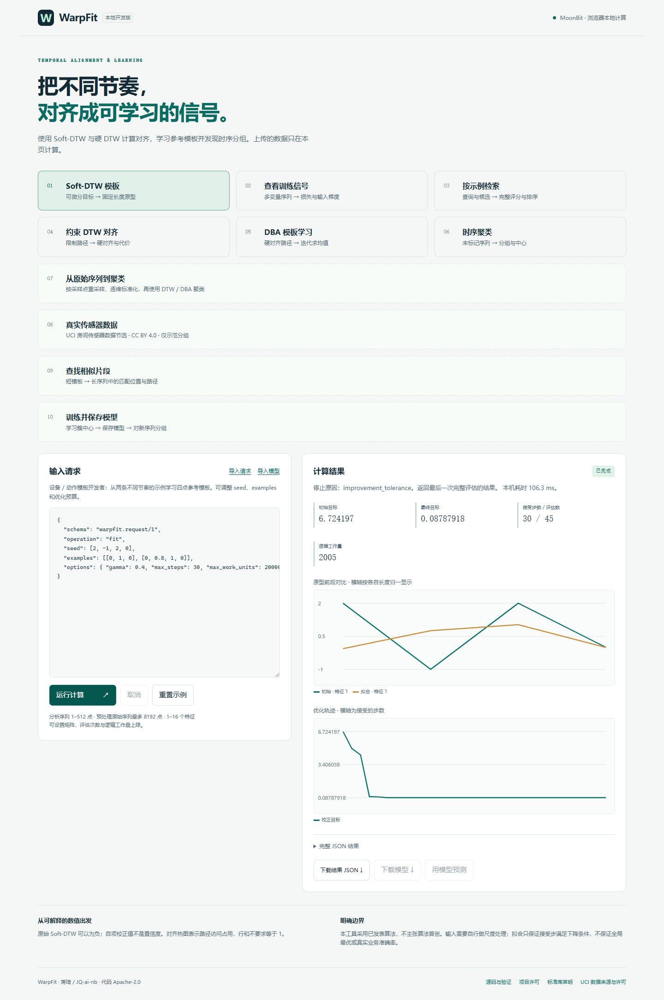

# WarpFit — MoonBit 时序对齐、模板学习、聚类与分类

覆盖重采样 → 逐维标准化 → 硬 DTW 约束对齐 → DBA 模板 → 聚类 → 最近邻分类 → 候选簇数选择 → 模型保存复用 → 子序列定位，全部有界预算。

本期新申报版本为 0.2.0：0.1.2 是已公开原型，0.2.0 在本期完成实质新增（26 个功能提交、12 个场景、四后端测试与 Mooncakes 发布）；新增清单见 [CHANGELOG](CHANGELOG.md) 与 [本期新增说明](docs/NOVEMBER.md)。

摘要，逐条见[完整工作流](#完整工作流)：

| 任务族 | 命令 | 已验证输出 |
|---|---|---|
| 约束对齐 | `node bin/warpfit.mjs examples/align.json` | 距离 0；把请求 JSON 的 `window` 改为 0 后平方代价 2 |
| 模板学习 | `node bin/warpfit.mjs examples/dba.json` | 目标 0.166667 → 0.118056 |
| 预处理 + 聚类 | `node bin/warpfit.mjs examples/pipeline.json` | 标签 `[0,0,1,1]` |
| 最近邻分类 | `node bin/warpfit.mjs examples/knn.json` | `rise`，投票 `[2,1]` |
| 候选簇数选择 | `node bin/warpfit.mjs examples/select-k.json` | `best_k=3`，轮廓系数 0.9544 |
| 模型保存与复用 | `node bin/warpfit-model.mjs train examples/model_train.json work/cluster-model.json && node bin/warpfit-model.mjs predict work/cluster-model.json examples/model_predict_data.json` | 新数据标签 `[0,1,0]` |

**版本披露**：源码为 0.2.1；Mooncakes 注册表当前版本以[包页面](https://mooncakes.io/docs/JQ-ai-nb/warpfit)为准（0.2.0 为上一版）；样例均为合成数据本地验证，非准确率或生产效果；验证记录分别标注本地检查、远程 CI 与注册表安装结果，本地结果不推断已发布状态。

[在线工作台](https://jq-ai-nb.github.io/warpfit/) ｜ [Mooncakes](https://mooncakes.io/docs/JQ-ai-nb/warpfit)

### 为什么在 MoonBit 重做

tslearn 需要 Python、numpy 与 scipy，无法嵌入 MoonBit 产物。本库提供同源 Wasm / Wasm-GC / JS 内核：浏览器 Worker 内本地计算、不经网络，预算在计算前校验，产物是单文件引擎、无外部运行时依赖。在线工作台即该内核的一个无后端实例：静态页面加载引擎，数据不上传。差异在部署位置，不在算法新颖性；与 tslearn 的数值对照和边界见验证文档。

### 不对齐会怎样

`[0,1,0,0]` 与 `[0,0,1,0]` 在 DTW 下距离为 0；逐点平均得到 `[0,0.5,0.5,0]`，峰值从 1 削到 0.5。以一条样例为初值的 DBA 模板保持 `[0,1,0,0]`、目标 0；以均值为初值则停在 0.5。DBA 是局部优化，初值会影响结果。

## 快速运行

需要 MoonBit SDK、Node.js ≥22；Python ≥3.10 用于独立验证，不是核心运行依赖。记录的本机工具链：moon 0.1.20261021 / moonc 0.10.17+093cb8f9c。CI 使用官方安装器的当前稳定 SDK，并在日志中记录实际版本。

```text
moon check --target all --deny-warn
moon test --target wasm-gc --deny-warn
moon run cmd/demo --target js
moon run cmd/calibrate --target js
moon run cmd/series_pipeline --target js
moon run cmd/consumer --target js
node scripts/build.mjs
node bin/warpfit.mjs examples/align.json
node bin/warpfit.mjs examples/dba.json
node bin/warpfit.mjs examples/clusters.json
node bin/warpfit.mjs examples/knn.json
node bin/warpfit.mjs examples/select-k.json
node bin/warpfit.mjs examples/pipeline.json
node bin/warpfit.mjs examples/uci-room.json
node bin/warpfit.mjs examples/subsequence.json
node bin/warpfit.mjs examples/prototype.json
node bin/warpfit.mjs examples/training.json --out result.json
node bin/warpfit.mjs examples/retrieval.json
node scripts/serve.mjs
```

最后打开 <http://127.0.0.1:4194>：选择场景，编辑 / 导入 JSON，运行后查看曲线、目标轨迹、梯度、热图或排序，下载完整结果。选择“训练并保存模型”可自动选择初始样本、训练、下载模型，再导入该文件并预测新数据。可终止 Worker 取消计算；输入仅在本机内存中处理，模型与结果由使用者主动下载。

保存和复用模型的文件流程（先构建引擎；模型输出文件需尚不存在）：

```text
node -e "require('node:fs').mkdirSync('work',{recursive:true})"
node bin/warpfit-model.mjs train examples/model_train.json work/cluster-model.json
node bin/warpfit-model.mjs predict work/cluster-model.json examples/model_predict_data.json
```

示例新数据的预测标签为 `[0,1,0]`。模型同时保存预处理和对齐参数；新数据可以只落在其中一个簇。簇编号只是到已学习中心的最近分配，没有监督分类或概率含义。模型 CLI 拒绝覆盖已有文件；训练预算耗尽时不写模型，返回退出码3及停止状态。

另有训练与验证分开的公开传感器数据流程：`node scripts/evaluate_holdout.mjs`。16段较早记录用于训练，另16段不重叠的后续记录用于文件模型加载后的预测；脚本输出训练状态、测试距离及训练初始中心的基线，完整方法见 [真实数据说明](docs/REAL_DATA.md)。单次固定划分只证明对应输入的结果，不能解读为分类准确率或生产效果。

库包导入：`"JQ-ai-nb/warpfit/core" @warpfit`。0.2.0 已发布到 [Mooncakes](https://mooncakes.io/docs/JQ-ai-nb/warpfit)；此前的 0.1.2 不包含本次新增接口。类型化示例见 [cmd/series_pipeline](cmd/series_pipeline/main.mbt)，签名见 [pkg.generated.mbti](core/pkg.generated.mbti)，JSON 与 CLI 契约见 [API.md](docs/API.md)。

## 完整工作流

以下新增示例是本地 0.2.0 的合成数据，执行前先运行 `node scripts/build.mjs`：

| 逐条工作流 | 输入 / 操作 | 已验证输出 |
|---|---|---|
| 生产信号分析开发者：周期信号存在有限的时间偏移 | `examples/align.json`，两条四点序列和 `window=1` | 返回完整硬 DTW 路径与距离 0；改为 `window=0` 时平方路径代价为 2 |
| 传感器模板开发者：重复动作长度不一致 | `examples/dba.json`，三条观测和四点初始模板 | 经硬 DTW 路径与 DBA 更新，目标从约 0.166667 降至 0.118056；返回模板、轨迹与终止原因 |
| 多设备分析开发者：量纲、长度不同且需按形状分组 | `examples/pipeline.json`，四条序列、两个初始样本下标 | 重采样、逐维标准化后分组标签 `[0,0,1,1]`，返回每条预处理统计、中心、目标和预算状态 |
| 分类应用开发者：已有带标签样本，需给新序列归属 | `examples/knn.json`，六条带标签训练序列、一条查询、`k=3` | 返回标签 `rise`、3 个邻居的标签 / 下标 / 距离及投票 `[2,1]`；平票按距离和与邻居顺序确定性决胜 |
| 分析开发者：不确定该分几组 | `examples/select-k.json`，六条序列、候选 `[2,3]` | 返回 `best_k=3`，各候选的轮廓系数 `0.7379` / `0.9544`、目标与标签；空簇候选记为缺席 |
| 离线数据应用开发者：希望训练一次后复用分组规则 | `examples/model_train.json` 自动初始化并保存模型；用 `examples/model_predict_data.json` 预测新批次 | 模型文件重新读取后返回标签 `[0,1,0]` 及到各中心距离；文件流程、预算和同簇预测有测试 |
| 片段检索开发者：查询信号只占长记录的一小段 | `examples/subsequence.json`，query=`[0,1,0]`，target=`[9,9,0,1,0,9,9]` | 距离0、匹配区间零基闭区间 `[2,4]` 及完整对齐路径；独立枚举与 tslearn 验证 |

原有 0.1.x 工作流在本地仍可运行：

| 使用者及问题 | 输入 / 操作 | 可验证输出 |
|---|---|---|
| 传感器 / 重复动作模板开发者：不同节奏无法直接按下标平均 | 两条不同长度观测、四点 seed；运行 `examples/prototype.json` | 返回四点模板、每步目标、停止原因、评估 / 工作量；固定合成例目标从 6.7241967 降至 0.08787918 |
| 时序模型开发者：需要能更新预测参数的损失 | 二维预测 / 目标运行 `examples/training.json`；`cmd/calibrate` 展示梯度接入独立增益 / 偏置模型 | 返回双方同形梯度与占用矩阵；校准示例目标从 1.1964749 降至 0.4136583，链式梯度有有限差分检查 |
| 离线数值应用开发者：要比较查询周期和候选形状 | 查询、三个候选、统一 gamma；运行 `examples/retrieval.json` | 全候选评分后返回排序，相同序列第一；不将分数当作分类概率 |

详见 [场景输入、输出及验证方法](docs/SCENARIOS.md)。上述三个场景使用可复现的合成数值；另有 [UCI 房间传感器真实数据节选](docs/REAL_DATA.md) 可运行完整分组流程。真实数据示例不代表设备采用、用户访谈或业务准确率证据。

## 实现范围

- 硬 DTW：加权平方局部代价、完整路径、确定性并列顺序及 Sakoe-Chiba 窗口；不等长窗口沿较长轴延伸。距离专用接口只保留两行 DP，并只计算允许的带内格点，供聚类分配与预测使用。
- 子序列 DTW：消费完整查询，允许目标的起止点开放，返回一个最小代价连续区间和路径；并列时选最早结束位置。支持多变量权重与矩阵预算，当前不支持窗口约束或多结果检索。
- 加权 DBA：按硬对齐路径迭代更新固定长度模板；明确记录目标、预算和停止原因，支持不同长度及特征权重。
- 最近邻分类：硬 DTW 距离上的 k 近邻多数投票，返回 k 个邻居、投票分布与每项距离；票数并列时比距离和，仍并列时按邻居顺序决胜。结果是投票而非概率，训练集上限 32 条。
- 簇数选择：候选 k 各自用确定性最远点初始化训练，按硬 DTW 距离计算平均轮廓系数并取最大；并列取较小 k，产生空簇的候选记为缺席。成对距离矩阵只算一次，与聚类共享预算。
- DTW k-means：调用方给初始中心，或在模型接口选择确定性最远点初始化；反复执行最近中心分配和 DBA 更新，空簇明确报错。自动初始化的工作量计入同一训练预算；未提供随机 k-means++；簇数只能在 `select_k` 的给定候选内按轮廓系数选择，不做无候选的簇数推断。
- 可保存的版本化模型：训练时保留中心、预处理策略和对齐参数，读取后直接预测新批次，输出簇编号及到全部中心的距离。模型文件经过严格 schema 和参数验证。
- 线性重采样、逐序列逐特征标准化，以及组合为“预处理 → 聚类”的类型接口和 JSON 工作流。
- 纯 MoonBit 数值核心，仅使用标准库；多变量平方欧氏代价、可配置非负特征权重、稳定 soft-min 前向和逆序求导。
- 原始目标与自项校正严格区分；校正梯度包含自项的两侧导数，不对结果任意截零。
- 带权模板拟合：缓存固定示例自项，Armijo 回溯、明确容忍度和六种停止原因；返回最后一个完整评估点。
- 完整候选排名：唯一 ID、稳定并列顺序、预先检查总预算，不返回部分排序。
- 严格、带版本的 JSON API；拒绝未知字段、重复键、不规则数组和错误预算类型。Node 文件 / stdin CLI 与浏览器使用同一个 MoonBit 引擎。
- DTW 等分析输入每条 1..512 采样、1..16 特征，值域 ±10000；预处理允许每条最多 8192 个原始采样点，但超过 512 点时必须先指定 1..512 个输出点。子序列定位的原始目标可达 8192 点，仍须满足查询长度×目标长度≤262144。每矩阵最多 262144 个格点。fit / rank / 模型批次最多 32 条；各操作的迭代上限见接口文档，逻辑工作量 ≤1e8。

复杂度和边界见 [SEMANTICS.md](docs/SEMANTICS.md)。工作量按完整矩阵格点 × 特征数保守计费，不是墙钟时限；预处理另受数据规模限制，不计入聚类工作量。完整路径接口仍分配完整 DP 矩阵；仅求距离的接口采用两行空间，`max_cells` 仍按完整逻辑矩阵保守限制。原始 Soft-DTW 可为负；DBA / 聚类不保证全局最优，初始中心与尺度选择会影响结果。重采样基于样本下标，不支持真实时间戳、抗混叠或缺失值；没有 GPU、实时设备接入、无候选的簇数推断或大规模索引。

目标用户是 MoonBit 时序模型、传感器周期与离线数值应用开发者。逐点误差和直接平均要求采样位置一致；调用者可以根据问题选择硬路径对齐、带梯度的软目标，或对未标记序列做分组。核心使用 MoonBit 标准库，不依赖 Python 运行时或外部学习服务；浏览器演示在本地 Worker 计算用户数据。

## 2026-11-18 源码增强（尚未进入 0.2.0 包）

新增 JSON 操作：`knn_pruned`（LB_Keogh 排序 + 精确 early abandon）、`subsequence_topk`、`cross_validate`、`medoids`、`motifs`、`outliers`、`describe`。这些能力当前只在公开 main 源码中，Mooncakes `0.2.0` 包不包含；发布包验证仍以 tag `v0.2.0` 为准。当前 main 的有效 MoonBit 源码约 5,002 行，测试 110 项。示例：`node bin/warpfit.mjs examples/knn-pruned.json`、`subsequence-topk.json`、`cross-validate.json`、`medoids.json`、`motifs.json`、`outliers.json`、`describe.json`。

## 验证与可复现性

```text
python verify.py
python exhaustive_oracle.py --check
node --test tests/model.test.mjs tests/model_cli.test.mjs tests/auto_model.test.mjs tests/subsequence.test.mjs tests/distance_only.test.mjs tests/long_input.test.mjs
node scripts/benchmark_hard.mjs
```

`node scripts/benchmark_hard.mjs` 除硬 DTW 与组合流程外，还测量 `knn`（32 条 256 点 × 3 维训练序列的单次 k=3 查询）与 `select_k`（32 条 64 点一维序列，候选 `[2,3]` 和 `[2,3,4]`），每行都断言 `ok:true` 并保留标签 / 邻居下标 / `best_k` / 轮廓系数作为正确性锚点。

`tests/knn_reference.py` 的三种用法：默认只把本次复算写到忽略目录 `artifacts/knn-reference.json`，并在末尾打印证据是否落后（`evidence: current` / `evidence: STALE`，不改变退出码），所以 `python verify.py` 不会弄脏工作树；`--evidence` 同时刷新 `docs/evidence/knn-reference.json`（固定 `newline="\n"`，除 `recorded_at_utc` / `python` 外无变化时跳过并打印 `evidence: unchanged`）；`--check-evidence` 只比较不写入，忽略 `recorded_at_utc`、`python` 与仅表示来源的 `engine_commit`，一致退出 0 打印 `evidence: current`，不一致退出 1 打印 `evidence: STALE` 并逐行列出差异键。

本地执行结果与真实命令见 [VALIDATION.md](docs/VALIDATION.md)。0.2.0 源码提交 `8195d88` 的 [CI 运行](https://github.com/JQ-ai-nb/warpfit/actions/runs/44095202653) 与发布文档提交 `fbd17a5` 的 [CI 运行](https://github.com/JQ-ai-nb/warpfit/actions/runs/44106313819) 均已通过 Linux / macOS / Windows × Wasm / Wasm-GC / JS / native 检查、构建和测试；本机 Wasm / Wasm-GC / JS 各 110 项 MoonBit 测试（0.2.0 发布包为 82 项，main 后续新增边界与能力测试）、Node 43 项、Chromium 浏览器 24 项通过。本机仍缺 MSVC，本机 native 未运行；远程 native 已通过。工作台部署随 main 更新，线上 24 项检查已通过；main 最新 CI 见 [Actions](https://github.com/JQ-ai-nb/warpfit/actions)。

本地新增最近邻分类与簇数选择后，本机 `moon test` 为 110 项、Node 测试为 43 项；0.2.0 源码提交 `8195d88` 已推送，后续文档提交不改变源码，main 最新 CI 见 [Actions](https://github.com/JQ-ai-nb/warpfit/actions)。本地验收维护、独立包消费检查与本轮本地新增检查的记录见 [验收自查](docs/ACCEPTANCE.md) 和 [机制与演示](docs/WALKTHROUGH.md)。

此前 0.1.2 的注册表独立消费测试和线上演示已有验证记录；0.2.0 已于 2026-11-17 发布到 [Mooncakes](https://mooncakes.io/docs/JQ-ai-nb/warpfit)，`python scripts/registry_consumer.py --version 0.2.0` 返回 `registry install verified: True`。

发布前可运行 `python scripts/package_check.py` 和 `python scripts/registry_consumer.py --packaged`：它在独立工程中只使用实际归档包，以冻结本地workspace检查并运行10组公共能力（原有8组，另加最近邻分类`knn`与选簇数`select_k`）。默认不带`--packaged`才从注册表安装。归档验证不能写成Mooncakes安装已通过，详情见 [消费验证说明](docs/API.md#独立消费与发布准备)。

新增硬 DTW 有 240 组小样例通过全路径穷举；另对照 tslearn 0.6.4 验证 160 组硬 DTW、80 组单步 DBA、9 组聚类、100 组预处理及一个完整流程。常量特征采用本库明确的阈值归零语义，与参考库的浮点边界行为有差异，单独披露于 [VALIDATION.md](docs/VALIDATION.md)。数值一致性不证明业务效果。

子序列定位另有256组独立路径枚举与120组 tslearn 参考对照；仅求距离的实现与完整路径实现对比1200组输入，并覆盖长度比例极端的窗口边界。没有据此宣称性能领先；结果见验证文档。

UCI 的六段真实环境传感器序列也已执行预处理与聚类，并用 tslearn 复算最终样本到中心的 12 个距离。数据按 [CC BY 4.0](https://creativecommons.org/licenses/by/4.0/) 引用，抽取方式与局限见 [REAL_DATA.md](docs/REAL_DATA.md)；它不是人数预测或实际产品采用证明。

新增16段训练 / 16段验证的模型文件流程，参考验证覆盖独立插值 / 标准化后的4608个数值、64个 DTW 距离和最终最近中心标签；详见 [固定划分实验](docs/REAL_DATA.md#训练后预测不重叠的后续数据)。该基线比较不代表与其他工具的性能或准确率比较。

## 与已有工作的关系

Soft-DTW 和自项校正来自 [Cuturi / Blondel 2017](https://proceedings.mlr.press/v70/cuturi17a.html) 与 [Blondel 等 2021](https://proceedings.mlr.press/v130/blondel21a.html)。其他语言已有成熟实现，不能把用 MoonBit 重写本身当作算法创新。

查证的 [MoonSTRtree 轨迹公开接口](https://github.com/LING71671/MoonSTRtree/blob/main/src/extensions/trajectory/pkg.generated.mbti)已有普通 DTW / Fréchet；[moon-geometry 的二维轨迹接口](https://github.com/walkzzz/moon-geometry/blob/main/spatial/dtw/pkg.generated.mbti)已有普通及窗口 DTW。两者与本项目存在实际重合；WarpFit 面向多变量数值序列，提供硬 / 软对齐、模板拟合、预处理到聚类的组合。[tslearn](https://github.com/tslearn-team/tslearn)已覆盖更广的相关算法，本项目不声称比它更完整、更快或更准确，也不把 MoonBit 重写、窗口 DTW 或 DBA 宣称为算法首创。

[Augurs 的 JS / WebAssembly 示例](https://github.com/grafana/augurs/blob/main/js/testpkg/clustering.test.ts)也已经使用 DTW 距离矩阵与聚类，因此不能把在浏览器中运行这些能力说成独有。更多已查明的相关项目和具体接口边界见下文的比较说明。

详细比较、检索限制及与既往工程的关系见 [RELATED_WORK.md](docs/RELATED_WORK.md)。未发现同类不等于生态不存在；没有完整审计全部公开 / 私有工程。本项目从论文公式独立编写数值核心，没有复制上述工程源码或测试夹具。许可与分发说明见 [THIRD_PARTY_NOTICES.md](THIRD_PARTY_NOTICES.md)。



## 维护者与许可

维护者 / 个人参赛申请人：**蒋琦**；GitHub / Mooncakes：**JQ-ai-nb**。Apache-2.0。设计、编码与测试使用 AI 辅助；维护者负责目标、边界、关键数值与发布结论的最终核对，AI 生成内容经过测试、独立参考与 CI 复核。算法来自公开论文，**不宣称算法首创或世界唯一**。
